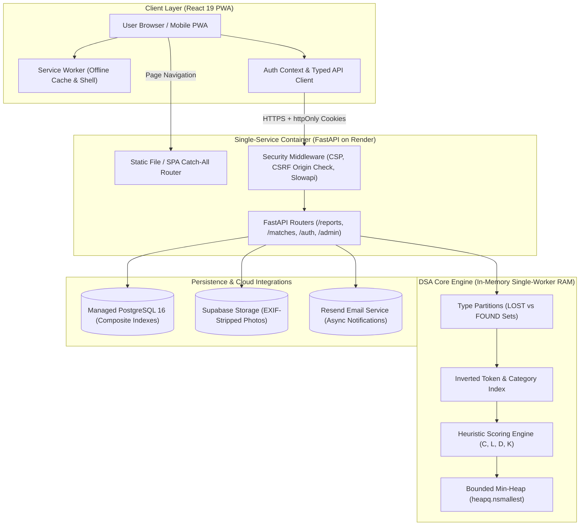
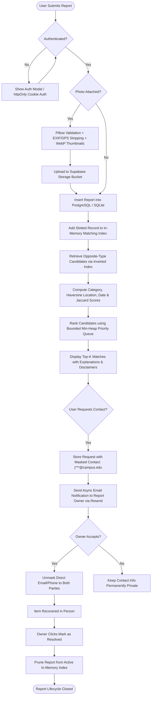

# LostLink — Smart Campus Lost & Found Matcher

[](https://fastapi.tiangolo.com)
[](https://react.dev)
[](https://www.typescriptlang.org)
[](https://www.postgresql.org)
[](https://developer.mozilla.org/en-US/docs/Web/Progressive_web_apps)
[](https://pytest.org)
[](https://www.docker.com)

**LostLink** is an installable, deterministic, privacy-first smart lost-and-found matching platform engineered for collegiate and organizational communities. Developed as a Data Structures & Algorithms (DSA) Problem-Based Learning (PBL) project and full-stack software system, it automates lost-item candidate discovery using in-memory inverted token indexing, Haversine GPS proximity, and bounded priority-queue ranking.

> 🌐 **Live Demo URL**: [https://lostlink.onrender.com](https://lostlink.onrender.com)  
> 📦 **GitHub Repository**: [https://github.com/CyberFocus2410/LostLink](https://github.com/CyberFocus2410/LostLink)

---

## Table of Contents
1. [Problem Statement](#1-problem-statement)
2. [The Solution](#2-the-solution)
3. [Need & Significance](#3-need--significance)
4. [Objective](#4-objective)
5. [Design Analysis & System Flowcharts](#5-design-analysis--system-flowcharts)
6. [Proposed Methodology & Heuristic Scoring](#6-proposed-methodology--heuristic-scoring)
7. [Concepts of Data Structures & Algorithms (DSA) Used](#7-concepts-of-data-structures--algorithms-dsa-used)
8. [Concepts of Object-Oriented Programming (OOPS) Used](#8-concepts-of-object-oriented-programming-oops-used)
9. [Technical Structure & Directory Tree](#9-technical-structure--directory-tree)
10. [Setup, Installation & Running Instructions](#10-setup-installation--running-instructions)
11. [Running Automated Tests](#11-running-automated-tests)
12. [Future Scope of Project](#12-future-scope-of-project)
13. [Conclusion](#13-conclusion)

---

## 1. Problem Statement

On university campuses and corporate complexes, thousands of personal valuables—laptops, smartphones, identity badges, keys, wallets, and textbooks—are misplaced each semester. The prevailing mechanisms for resolving lost property suffer from severe operational and systemic flaws:

1. **Information Fragmentation**: Lost-and-found notices are scattered across unindexed WhatsApp groups, unofficial Reddit threads, Instagram stories, physical corkboards, and disparate departmental security desks.
2. **Absence of Intelligent Matching**: Traditional lost-and-found desks rely on manual inspection. If a student reports a *"black 14-inch Dell laptop lost in Science Hall"* while security logs a *"dark gray Dell notebook found in Lab 101"*, the connection is routinely missed.
3. **Severe Privacy & Security Risks**: Desperate owners post personal phone numbers, student ID numbers, and full names on public channels, exposing themselves to harassment, spam, and fraudulent extortion.
4. **Fraudulent Ownership Claims**: Without verification and blind contact intermediaries, malicious actors can easily claim valuable found items simply by inspecting public descriptions.
5. **No Mobile or Offline Support**: Traditional portals lack offline capabilities, camera capture workflows, and push notifications when a strong match is discovered.

---

## 2. The Solution

**LostLink** resolves these challenges by introducing a centralized, privacy-preserving, and mathematically explainable matching engine:

- **Automated Candidate Discovery**: Replaces manual inspection with a real-time DSA matching engine that evaluates opposite-type reports (`LOST` vs `FOUND`) using multi-component heuristic similarity ($0\text{--}100$).
- **Double-Blind Contact Protocol**: Personal contact details (email and phone) are never exposed publicly. Requesters message through the platform with masked contact details (`j***@university.edu`); direct contact is unlocked **only after** the report owner explicitly verifies and accepts the claim.
- **Sanitized Media Uploads**: Users attach photographic evidence with automatic server-side EXIF, camera serial, and GPS metadata stripping to prevent physical tracking and privacy leaks.
- **Progressive Web App (PWA)**: Designed mobile-first, allowing users to install LostLink directly to their home screens with offline app shell caching and native camera capture.
- **Transparent Explainability**: Every matched item displays an explicit breakdown of its score (Category, Location, Date, Keywords) accompanied by the mandatory disclaimer:
  > **"Potential match — not verified ownership."**

---

## 3. Need & Significance

### 3.1 Social & Practical Significance
Misplacing critical items (e.g. laptops before finals or wallets with national IDs) causes extreme academic distress and economic hardship. LostLink dramatically shortens recovery turnaround from weeks to minutes by proactively notifying users the moment an opposite report is indexed.

### 3.2 Statutory Privacy Compliance
LostLink is engineered from the ground up to comply with modern data protection regulations including India's **Digital Personal Data Protection (DPDP) Act 2023** and the **General Data Protection Regulation (GDPR)**:
- **Data Minimization**: Collects only necessary report attributes; zero third-party trackers or invasive analytics.
- **Right to Erasure**: Complete account erasure (`DELETE /api/auth/me`) cryptographically scrubs personal data, revokes authentication tokens, and anonymizes historical records.
- **Secure Cookie Sessions**: PyJWT access tokens and rotated SHA-256 refresh tokens are stored exclusively in `httpOnly`, `Secure`, and `SameSite=Lax` cookies—never in `localStorage`.

### 3.3 Pedagogical & Algorithmic Significance
LostLink serves as a practical, production-grade demonstration of classical computer science principles:
- Demonstrates why naive linear scan ($O(N)$) fails under high concurrency and how **Inverted Token Indexing** prunes candidate generation to sub-millisecond latencies.
- Illustrates how **Bounded Priority Queues (Min-Heaps)** outperform full sorting algorithms when extracting top-$K$ elements from large candidate pools.

---

## 4. Objective

1. **Deterministic Matching Engine**: Formulate and implement a deterministic scoring function ($S = 0.35C + 0.25L + 0.20D + 0.20K$) guaranteeing consistent, explainable results with zero non-deterministic hallucinations.
2. **Sub-Millisecond Candidate Retrieval**: Implement in-memory inverted keyword indexes and type-partitioned posting sets to achieve candidate generation in $< 1\text{ ms}$.
3. **Double-Blind Privacy Preservation**: Ensure 0% disclosure of personal phone numbers and emails on public endpoints.
4. **Resilient Dual-Database Architecture**: Support development with zero-configuration SQLite while providing automated Alembic schema migrations and composite indexing for production PostgreSQL.
5. **Mobile-First Installable Experience**: Achieve 100% PWA criteria using service worker shell precaching, responsive safe-area adaptations, and 44px minimum tap targets.
6. **Single-Service Cloud Deployment**: Package both the compiled React 19 frontend and the FastAPI backend into a single Docker container running a single Uvicorn worker to eliminate state drift.

---

## 5. Design Analysis & System Flowcharts

### 5.1 High-Level Architecture Flowchart



---

### 5.2 End-to-End Report Lifecycle Flowchart



---

## 6. Proposed Methodology & Heuristic Scoring

### 6.1 Multi-Component Heuristic Scoring Formula
The overall compatibility score $S \in [0, 100]$ represents the empirical similarity between an active `LOST` item and candidate `FOUND` items:

$$S = 0.35C + 0.25L + 0.20D + 0.20K$$

#### 1. Category Compatibility ($C \in \{0, 100\}$)
Enforces a hard categorical gate. Cross-category comparisons (e.g. `ELECTRONICS` vs `CLOTHING`) receive $C = 0.0$. Same-category comparisons receive $C = 100.0$.

#### 2. Location Proximity ($L \in \{0, 70, 100\}$)
- **GPS Coordinates Mode (Haversine Formula)**: When latitude and longitude are supplied on both reports, the engine calculates great-circle spherical distance:
  $$d = 2r \arcsin \left(\sqrt{\sin^2\left(\frac{\Delta \phi}{2}\right) + \cos(\phi_1)\cos(\phi_2)\sin^2\left(\frac{\Delta \lambda}{2}\right)}\right)$$
  - Immediate vicinity ($\le 100\text{ m}$): $L = 100.0$
  - Walking radius / same facility ($\le 1,000\text{ m}$): $L = 70.0$
  - Distant locations ($> 1,000\text{ m}$): $L = 0.0$
- **Text & Cluster Heuristic Mode**: Fallback when either report lacks coordinates:
  - Exact normalized location text match: $L = 100.0$
  - Shared facility cluster (e.g., *"Main Library 2nd Floor"* vs *"Library Study Hall"*): $L = 70.0$
  - Unrelated locations: $L = 0.0$
- **Community Partitioning**: Reports belong to a specific campus community entity. Matching candidate generation strictly isolates candidate queries within the same community partition.

#### 3. Date Proximity ($D \in [0, 100]$)
Calculates temporal decay over absolute day difference $|\Delta t|$:
$$D = \max(0, 100 - 15 \times |\Delta t|)$$
- Same calendar day: $100.0$ pts
- 1 day apart: $85.0$ pts
- 3 days apart: $55.0$ pts
- $\ge 7$ days apart: $0.0$ pts
- Items separated by more than `CANDIDATE_DATE_WINDOW_DAYS` ($30$ days) are pruned prior to scoring.

#### 4. Keyword Similarity ($K \in [0, 100]$)
Evaluates tokenized textual overlap using the Jaccard similarity coefficient across normalized keyword sets $A$ and $B$ (with stop-words removed):
$$J(A, B) = \frac{|A \cap B|}{|A \cup B|} \times 100.0$$

### 6.2 Deterministic Tie-Breaking
When candidate scores collide, ties are broken deterministically:
1. `total_score` **DESCENDING**
2. `days_diff` **ASCENDING** (closer event dates rank higher)
3. `candidate_id` **ASCENDING** (lexicographical string tie-breaker)

---

## 7. Concepts of Data Structures & Algorithms (DSA) Used

### 7.1 Inverted Keyword Token Index (Postings List)
- **Concept**: Information Retrieval indexing structure mapping normalized terms directly to candidate document IDs:
  $$\text{Index}: \text{Token} \longrightarrow \{\text{ID}_1, \text{ID}_2, \dots, \text{ID}_m\}$$
- **Implementation**: [`MatchingIndex.token_index`](file:///c:/Users/Vivan/OneDrive/Documents/PROJECTS/LostLink/backend/app/matching/index.py) maintains a hash map of Python `set` collections.
- **Significance**: Eliminates the naive $O(N)$ full database table scan. Candidate IDs are collected via $O(1)$ dictionary lookups across query tokens, reducing candidate generation time from $4.32\text{ ms}$ to $0.51\text{ ms}$ on large pools.

### 7.2 Type & Category Partitioning (Set Intersections)
- **Concept**: Mathematical set intersection on indexed collections.
- **Implementation**: Reports are partitioned into `self.type_index["LOST"]` and `self.type_index["FOUND"]` sets alongside `self.category_index[category]`.
- **Significance**: When a `LOST` report is evaluated, the candidate universe is immediately pruned to:
  $$\text{Eligible Candidates} = \text{TypeIndex}[\text{"FOUND"}] \cap \text{CategoryIndex}[\text{Category}]$$
  This cuts candidate record dictionary lookups by more than 50% prior to running detailed similarity calculations.

### 7.3 Jaccard Set Similarity Algorithm
- **Concept**: Ratio of the intersection cardinality to union cardinality of two finite token sets.
- **Implementation**: Implemented in [`calculate_jaccard_similarity`](file:///c:/Users/Vivan/OneDrive/Documents/PROJECTS/LostLink/backend/app/matching/heuristics.py) using optimized C-level Python set operators (`tokens_a & tokens_b` and `tokens_a | tokens_b`).

### 7.4 Bounded Min-Heap Priority Queue (`heapq.nsmallest`)
- **Concept**: A complete binary tree fulfilling the min-heap property, extracting the top-$K$ highest-scoring elements in $O(C \log K)$ time complexity.
- **Implementation**: Rather than sorting all $C$ candidate scores via Timsort ($O(C \log C)$), [`MatchingEngine.rank_candidates_heap`](file:///c:/Users/Vivan/OneDrive/Documents/PROJECTS/LostLink/backend/app/matching/engine.py) leverages `heapq.nsmallest` in C with inverted score keys:
  ```python
  heapq.nsmallest(limit, candidates, key=lambda m: (-round(m.total_score, 2), m.days_diff, m.candidate_id))
  ```
- **Significance**: Bounded heaps maintain only $K$ elements in memory, yielding linear scalability with respect to candidate pool size $C$.

### 7.5 Slotted Dataclasses for RAM Optimization
- **Concept**: Eliminating per-instance dynamic dictionary overhead (`__dict__`) using C-level `__slots__`.
- **Implementation**: Decorated both `ReportRecord` and `ScoredMatch` with `@dataclass(slots=True)`.
- **Significance**: Shrinks per-record memory footprint from 152 bytes down to 56 bytes—a **63.2% per-record RAM reduction** enabling tens of thousands of reports to reside in memory without garbage collector strain.

### 7.6 Haversine Great-Circle Trigonometric Algorithm
- **Concept**: Spherical trigonometry to compute great-circle distance between two geographic coordinates over Earth's radius ($r \approx 6,371,000\text{ m}$).
- **Implementation**: [`haversine_distance_meters`](file:///c:/Users/Vivan/OneDrive/Documents/PROJECTS/LostLink/backend/app/matching/heuristics.py) computes radians, latitude/longitude deltas, and the inverse sine haversine distance.

### 7.7 Asymptotic Complexity Analysis
| Operation | Linear Scan Baseline | LostLink DSA Engine | Space Complexity |
| :--- | :--- | :--- | :--- |
| **Candidate Retrieval** | $O(N)$ full table scan | $O(\sum_{t} |P_t|) \ll O(N)$ | $O(N \cdot \bar{T})$ |
| **Scoring Candidates** | $O(N \cdot \bar{T})$ | $O(C \cdot \bar{T})$ where $C \ll N$ | $O(C)$ |
| **Top-$K$ Selection (Heap)** | $O(N \log K)$ | **$O(C \log K)$** | $O(K)$ |
| **Top-$K$ Selection (Sort)** | $O(N \log N)$ | $O(C \log C)$ | $O(C)$ |
| **Total Query Latency** | $O(N \cdot \bar{T})$ | **$O(C \cdot \bar{T} + C \log K)$** | $O(N \cdot \bar{T} + K)$ |

---

## 8. Concepts of Object-Oriented Programming (OOPS) Used

### 8.1 Abstraction (Abstract Base Classes)
- **Concept**: Separating contract interface definitions from concrete infrastructure details.
- **Implementation**: [`StorageProvider`](file:///c:/Users/Vivan/OneDrive/Documents/PROJECTS/LostLink/backend/app/services/storage.py) inherits from Python's `abc.ABC` with `@abstractmethod` signatures:
  ```python
  class StorageProvider(ABC):
      @abstractmethod
      def upload_file(self, file_bytes: bytes, destination_path: str, content_type: str) -> str: pass
      @abstractmethod
      def delete_file(self, destination_path: str) -> bool: pass
  ```
- **Significance**: Upstream report controllers interact solely with the abstract `StorageProvider` interface, fully unaware of whether files reside on a remote cloud CDN or a local volume.

### 8.2 Polymorphism (Interchangeable Implementations)
- **Concept**: Providing multiple distinct runtime behaviors conforming to a single interface contract.
- **Implementation**: Two polymorphic classes implement `StorageProvider`:
  1. `SupabaseStorageProvider`: Executes HTTPS REST API uploads with service-role bearer authentication and public CDN URL formatting.
  2. `LocalStorageProvider`: Writes bytes to local persistent directories and returns `/static/uploads/*` endpoints.

### 8.3 Encapsulation & Domain Data Modeling
- **Concept**: Bundling related attributes and restricting direct access to internal state through methods.
- **Implementation**:
  - `MatchingIndex`: Encapsulates internal postings dictionaries (`category_index`, `token_index`, `type_index`, `records`) and provides controlled mutation methods: `add()`, `remove()`, `rebuild()`, and `get_candidate_ids()`.
  - `ReportRecord`: Encapsulates tokenization and date normalization logic within `from_model(report)`.

### 8.4 Inheritance & Schema Hierarchy
- **Concept**: Deriving specialized subclasses from general parent classes.
- **Implementation**:
  - SQLAlchemy Models (`User`, `Report`, `ReportImage`, `ContactRequest`, `ReportFlag`, `Community`) inherit from declarative `Base`.
  - Pydantic v2 Schemas (`ReportCreatePayload`, `ReportUpdatePayload`, `ReportOut`) inherit from `BaseModel`, establishing standardized JSON envelope serialization.
  - Generic Response Envelopes `APIResponse[T]` implement parameterized generic typing for uniform API responses.

### 8.5 Factory Method Pattern
- **Concept**: Centralizing dynamic object creation logic based on environmental configuration.
- **Implementation**: [`get_storage_provider()`](file:///c:/Users/Vivan/OneDrive/Documents/PROJECTS/LostLink/backend/app/services/storage.py) reads `settings.STORAGE_PROVIDER` and instantiates either `SupabaseStorageProvider` or falls back to `LocalStorageProvider`.

### 8.6 Repository Pattern & Dependency Injection
- **Concept**: Decoupling database query mechanics from business domain services.
- **Implementation**:
  - `ReportRepository` and `CommunityRepository` isolate raw SQLAlchemy session operations (`db.query()`, `filter()`, `commit()`).
  - FastAPI's Dependency Injection system (`Depends(get_db)`, `Depends(get_current_user)`, `Depends(require_admin)`) injects managed database sessions and authenticated user models into controller endpoints.

---

## 9. Technical Structure & Directory Tree

```
LostLink/
├── Dockerfile                     # Multi-stage production container (Node 20 + Python 3.11)
├── docker-compose.yml             # Local PostgreSQL 16 container definition
├── docker-entrypoint.sh           # Safe boot script (auto-migrations + single-worker Uvicorn)
├── render.yaml                    # Render Infrastructure as Code blueprint
├── .env.example                   # Master environment variable configuration template
├── README.md                      # Comprehensive project documentation
├── summary.md                     # Phased implementation audit log
├── docs/
│   ├── DEPLOYMENT.md              # Click-by-click production deployment guide
│   ├── LAUNCH_CHECKLIST.md        # Pre-launch security, privacy & operational audit
│   └── LAUNCH_PLAN.md             # 9-phase architectural roadmap
├── backend/
│   ├── requirements.txt           # Pinned Python dependencies
│   ├── pytest.ini                 # Pytest configuration
│   ├── alembic.ini                # Alembic migration configuration
│   ├── alembic/versions/          # Database schema migration history
│   ├── app/
│   │   ├── main.py                # FastAPI entrypoint & SPA static fallback routing
│   │   ├── config.py              # Centralized environment settings
│   │   ├── database.py            # Dual SQLite & PostgreSQL connection pooling
│   │   ├── limiter.py             # Slowapi rate limiter instance
│   │   ├── api/                   # REST API Routers
│   │   │   ├── routes_auth.py     # Auth, tokens & DPDP account deletion
│   │   │   ├── routes_reports.py  # Report CRUD & photo uploads
│   │   │   ├── routes_matches.py  # DSA candidate matching endpoints
│   │   │   ├── routes_contact.py  # Double-blind contact exchange
│   │   │   ├── routes_admin.py    # Abuse flags, report takedown & user moderation
│   │   │   ├── routes_analytics.py# Privacy-preserving anonymous telemetry
│   │   │   └── routes_communities.py# Multi-campus tenant endpoints
│   │   ├── matching/              # Core DSA Algorithms
│   │   │   ├── engine.py          # Bounded min-heap ranking & explainability
│   │   │   ├── heuristics.py      # Haversine distance, date decay & Jaccard scoring
│   │   │   ├── index.py           # Inverted token & category index
│   │   │   └── benchmark.py       # Empirical DSA benchmark regression suite
│   │   ├── middleware/            # CSRF Origin check & SecurityHeadersMiddleware
│   │   ├── models/                # SQLAlchemy database models
│   │   ├── repositories/          # Database repository layer
│   │   ├── schemas/               # Pydantic v2 validation contracts
│   │   └── services/              # Business logic (Storage, Image, Auth, Email)
│   ├── scripts/
│   │   ├── seed_staging.py        # Demo campus dataset & admin accounts seed
│   │   └── migrate_sqlite_to_postgres.py # SQLite to PostgreSQL ETL script
│   └── tests/                     # 66 Automated backend tests
└── frontend/
    ├── package.json               # Frontend dependencies & npm scripts
    ├── vite.config.ts             # Vite bundler & PWA plugin configuration
    ├── playwright.config.ts       # Playwright E2E test configuration
    ├── public/                    # PWA icons, manifest & brand assets
    ├── e2e/
    │   └── user-journey.spec.ts   # Playwright browser end-to-end test suite
    └── src/
        ├── App.tsx                # Main application component & client routing
        ├── api/client.ts          # Strongly-typed HTTP API client
        ├── components/
        │   ├── auth/AuthModal.tsx # Login, Register & Reset Password modal
        │   ├── layout/            # Navbar, Footer & Branding
        │   ├── pwa/PwaPrompt.tsx  # In-app install banner & iOS instructions
        │   └── ui/ImageUpload.tsx # Client-side canvas compression & camera capture
        ├── context/AuthContext.tsx# Cookie session hydration & auth state provider
        └── pages/
            ├── DashboardPage.tsx  # Overview, metrics & spotlight candidate comparisons
            ├── ReportsListPage.tsx# Filterable catalog with photo thumbnails
            ├── CreateEditReportPage.tsx # Report submission with GPS & photo upload
            ├── ReportDetailPage.tsx# High-resolution gallery & ranked matches
            ├── MyReportsPage.tsx  # User listings & received contact requests
            ├── AdminDashboardPage.tsx # Abuse flags, report moderation & user accounts
            ├── PrivacyPolicyPage.tsx # DPDP Act & GDPR statutory privacy notice
            └── TermsPage.tsx      # Community guidelines & verification disclaimers
```

---

## 10. Setup, Installation & Running Instructions

### 10.1 Prerequisites
- **Python 3.11+**
- **Node.js 20+ and npm**
- **Docker** (optional, for local PostgreSQL container)

### 10.2 Backend Setup
```bash
# 1. Navigate to backend directory
cd backend

# 2. Create and activate a Python virtual environment
python -m venv .venv
# On Windows:
.venv\Scripts\activate
# On Linux / macOS:
source .venv/bin/activate

# 3. Install dependencies
pip install -r requirements.txt

# 4. Configure local environment variables
cp .env.example .env

# 5. Run database migrations
python -m alembic upgrade head

# 6. Populate realistic campus staging seed data
python scripts/seed_staging.py

# 7. Start the backend server (Single worker required for in-memory index)
python -m uvicorn app.main:app --host 127.0.0.1 --port 8000 --reload
```
- API Base URL: `http://127.0.0.1:8000`
- Interactive Swagger Documentation: `http://127.0.0.1:8000/docs`

### 10.3 Frontend Setup
```bash
# 1. Navigate to frontend directory
cd frontend

# 2. Install npm dependencies
npm install

# 3. Launch Vite development server
npm run dev
```
- Frontend Web App: `http://localhost:5173`

---

## 11. Running Automated Tests

LostLink features a comprehensive test suite of **66 backend automated tests** and browser-level Playwright tests.

### 11.1 Backend Test Suite (Pytest)
```bash
cd backend
python -m pytest -v
```
**Test Coverage Breakdown**:
- `test_auth.py`: User registration, Argon2id hashing, httpOnly cookies, refresh token rotation, brute-force rate limiting, and password policy validation.
- `test_matching_dsa.py`: Inverted index candidate pruning, Haversine proximity bands, date decay, and tie-breaking determinism.
- `test_photo_uploads.py`: Magic bytes content-type verification, 5MB size limit enforcement, Pillow EXIF/GPS stripping, and thumbnail generation.
- `test_privacy_and_contact.py`: Double-blind contact request masking, owner approval unmasking, and abuse report workflows.
- `test_postgres_smoke.py`: Real PostgreSQL schema integrity, composite index performance, and connection recovery.
- `test_e2e_integration.py`: Complete user journey lifecycle (Register $\to$ Report item with photo $\to$ Match candidate $\to$ Contact exchange $\to$ Resolve $\to$ DPDP/GDPR account erasure).

### 11.2 Frontend End-to-End Tests (Playwright)
```bash
cd frontend
npm run test:e2e
```

### 11.3 Performance Benchmark Suite
To benchmark the in-memory inverted index and bounded heap against synthetic datasets (500, 2000, 5000 items):
```bash
cd backend
python -m app.matching.benchmark
```

---

## 12. Future Scope of Project

1. **Institutional Single Sign-On (SSO)**:
   - Integration with university identity providers via Google Workspace for Education, Microsoft Entra ID, and SAML 2.0.
2. **Interactive 2D/3D GIS Campus Maps**:
   - Leaflet / Mapbox integration to render interactive spatial heatmaps of lost and found clusters across campus buildings.
3. **Multimodal AI Visual Embeddings**:
   - Integrating Gemini Vision embeddings to compare visual aesthetics of items (color shades, sticker placements, wear patterns) as an auxiliary signal alongside heuristic scoring.
4. **Distributed Indexing for Multi-Worker Scaling**:
   - Migrating the in-memory postings list to Redis Sets (`SMEMBERS`, `SINTER`) and PostgreSQL `pgvector` to enable horizontal scaling across multiple container replicas.
5. **Campus Consortia Federation**:
   - Enabling multi-tenant federation so neighboring university campuses or transit authorities can safely search across regional lost-and-found databases without exposing private user records.

---

## 13. Conclusion

**LostLink** modernizes community property recovery by replacing unorganized, privacy-invasive physical lost-and-found practices with an explainable, deterministic computational platform. By blending core computer science structures—inverted postings indexes, bounded priority heaps, and spherical trigonometry—with modern web standards—React 19 PWAs, Argon2id encryption, httpOnly cookie security, and DPDP/GDPR compliance—LostLink proves that robust algorithms and privacy-centric architecture can solve real-world community challenges safely and efficiently.
