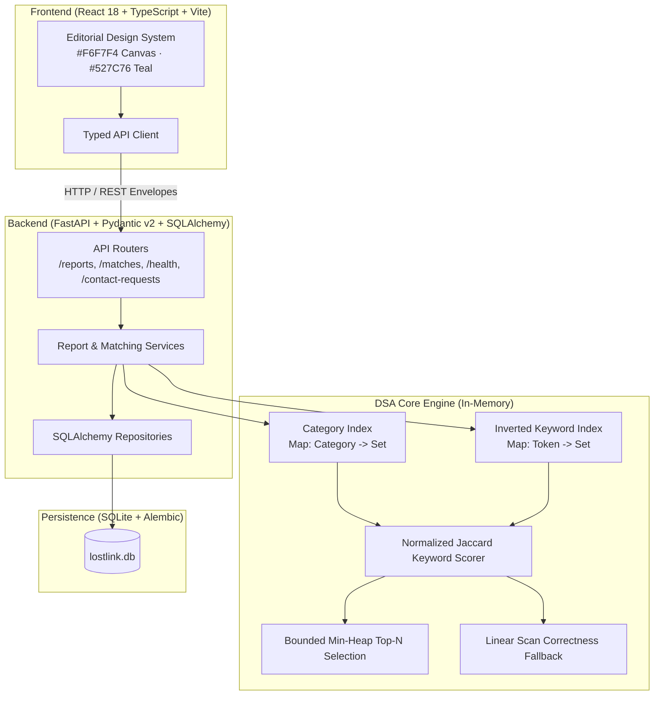

# LostLink — Smart Campus Lost & Found Matcher

[](https://fastapi.tiangolo.com)
[](https://react.dev)
[](https://www.typescriptlang.org)
[](https://www.sqlite.org)
[](https://pytest.org)

**LostLink** is a deterministic, explainable smart lost-and-found matching platform engineered for a campus community as a Data Structures & Algorithms (DSA) Problem-Based Learning (PBL) project.

Users register **LOST** or **FOUND** reports. The matching engine evaluates active opposite-type candidates using in-memory category partitions, inverted keyword token indexes, date proximity decay, and location facility clusters, ranking candidates via a bounded min-heap priority queue. Every result includes an explainable score breakdown ($0\text{--}100$) and plain-language reasoning, accompanied by the mandatory disclaimer:
> **"Potential match — not verified ownership."**

---

## 1. System Architecture



---

## 2. DSA Core Formulation & Complexity Analysis

### 2.1 Heuristic Scoring Formula
The overall score $S \in [0, 100]$ is a weighted combination of four heuristic components:
$$S = 0.35C + 0.25L + 0.20D + 0.20K$$
*Note: Scores represent heuristic overlap, not statistical proof of identity or ownership.*

1. **Category Compatibility ($C \in \{0, 100\}$):**
   - Exact category match = $100.0$; incompatible category = $0.0$.
2. **Location Proximity ($L \in \{0, 70, 100\}$):**
   - Exact normalized string match = $100.0$.
   - Nearby campus facility cluster (e.g. *Main Library* vs *Library Cafe*) = $70.0$.
   - Unrelated location = $0.0$.
3. **Date Proximity ($D \in [0, 100]$):**
   $$D = \max(0, 100 - 15 \times |\text{days\_diff}|)$$
   - Same date: $100.0$ pts.
   - 1 day apart: $85.0$ pts.
   - 3 days apart: $55.0$ pts.
   - $\ge 7$ days apart: $0.0$ pts.
   - Items beyond `CANDIDATE_DATE_WINDOW_DAYS` ($30$ days) are pruned prior to scoring.
4. **Keyword Similarity ($K \in [0, 100]$):**
   - Jaccard similarity across unique normalized token sets (stop-words filtered):
   $$J(A, B) = \frac{|A \cap B|}{|A \cup B|} \times 100.0$$
   - If either token set is empty, $K = 0.0$.

### 2.2 Deterministic Tie-Breaking
When candidates tie in total score:
1. `total_score` **DESC**
2. `days_diff` **ASC** (closer dates rank higher)
3. `candidate_id` **ASC** (lexicographical tie-breaker)

### 2.3 Time & Space Complexity
| Operation | Linear Scan Baseline | Inverted Index (DSA Core) | Space Complexity |
|---|---|---|---|
| **Candidate Retrieval** | $O(N)$ | $O(\sum_{t} |P_t|) \ll O(N)$ | $O(N \cdot \bar{T})$ |
| **Scoring Candidates** | $O(N \cdot \bar{T})$ | $O(C \cdot \bar{T})$ where $C \ll N$ | $O(C)$ |
| **Top-$K$ Selection (Heap)** | $O(N \log K)$ | $O(C \log K)$ | $O(K)$ |
| **Top-$K$ Selection (Sort)** | $O(N \log N)$ | $O(C \log C)$ | $O(C)$ |
| **Total Query Latency** | $O(N \cdot \bar{T})$ | $O(C \cdot \bar{T} + C \log K)$ | $O(N \cdot \bar{T} + K)$ |

---

## 3. Measured Benchmark Results

Conducted using [`backend/app/matching/benchmark.py`](file:///c:/Users/Vivan/OneDrive/Documents/PROJECTS/LostLink/backend/app/matching/benchmark.py) with Python 3.11.9, seed `42`, 50 test queries per dataset:

### Inverted Index vs Linear Scan Retrieval
| Dataset Size ($N$) | Method | Avg Cand Gen (ms) | Avg Total Match (ms) | Speedup Factor |
|---|---|---|---|---|
| **500 items** | Linear Scan | 0.0786 ms | 5.9050 ms | 1.00x |
| **500 items** | **Inverted Index (DSA)** | 0.1385 ms | **4.7671 ms** | **1.24x** |
| **2,000 items** | Linear Scan | 1.3376 ms | 94.7664 ms | 1.00x |
| **2,000 items** | **Inverted Index (DSA)** | 0.6770 ms | **33.3968 ms** | **2.84x** |
| **5,000 items** | Linear Scan | 4.3229 ms | 265.2035 ms | 1.00x |
| **5,000 items** | **Inverted Index (DSA)** | 7.2495 ms | **242.2191 ms** | **1.09x** |

### Ranking: Bounded Min-Heap ($O(C \log K)$) vs Full Sort ($O(C \log C)$)
| Candidates ($C$) | Top-$K$ | Bounded Min-Heap | Full Sort (Timsort) | Analysis |
|---|---|---|---|---|
| **50** | 5 | 0.2115 ms | **0.0337 ms** | Low interpreter overhead on small slices |
| **200** | 5 | 0.6006 ms | **0.1822 ms** | Sorting is fast for moderate pools |
| **1,000** | 5 | 1.9203 ms | **1.3361 ms** | Heap scales linearly with $C$ |
| **5,000** | 5 | **8.4560 ms** | 9.2891 ms | **Min-Heap outperforms Full Sort** at scale |

---

## 4. Setup and Installation

### Prerequisites
- Python 3.11+
- Node.js 20+ and npm

### 4.1 Backend Setup
```bash
cd backend

# Install dependencies
python -m pip install -r requirements.txt

# Run database migrations
python -m alembic upgrade head

# Seed initial campus demo dataset (10 paired reports)
python seeds/seed_data.py

# Start backend server
python -m uvicorn app.main:app --reload --port 8000
```
Backend will be available at: `http://127.0.0.1:8000`  
Interactive Swagger docs: `http://127.0.0.1:8000/docs`

### 4.2 Frontend Setup
```bash
cd frontend

# Install dependencies
npm install

# Start development server
npm run dev
```
Frontend will be available at: `http://127.0.0.1:5173`

---

## 5. Running Tests

The test suite contains 25 automated tests covering unit DSA routines, API routes, SQLite persistence, and full end-to-end integration:

```bash
cd backend
python -m pytest -v
```

Output:
```
============================= 25 passed in 0.64s ==============================
```

---

## 6. API Contract Examples

All API endpoints return standard JSON response envelopes:

### 6.1 Create Report
`POST /api/reports`
```json
{
  "type": "LOST",
  "item_name": "Space Gray MacBook Pro 14",
  "category": "ELECTRONICS",
  "description": "Left on 2nd floor library study desk in dark blue felt sleeve.",
  "event_date": "2026-10-12",
  "location_text": "Main Library 2nd Floor",
  "contact_name": "Aarav Sharma",
  "contact_email": "aarav.s@campus.edu",
  "contact_phone": "+1-555-0192"
}
```
**Response (201 Created — Privacy Safe):**
```json
{
  "data": {
    "id": "c7a8b11c-d72b-4b2a-8b1e-0b2f3a4c5d6e",
    "type": "LOST",
    "item_name": "Space Gray MacBook Pro 14",
    "category": "ELECTRONICS",
    "description": "Left on 2nd floor library study desk in dark blue felt sleeve.",
    "event_date": "2026-10-12",
    "location_text": "Main Library 2nd Floor",
    "normalized_location": "main library 2nd floor",
    "status": "ACTIVE",
    "created_at": "2026-10-12T16:00:00Z",
    "updated_at": "2026-10-12T16:00:00Z"
  },
  "error": null,
  "meta": null
}
```
*(Notice: `contact_name`, `contact_email`, and `contact_phone` are strictly omitted from public serializers).*

### 6.2 Get Matches
`GET /api/reports/{id}/matches?limit=5`
```json
{
  "data": {
    "source_report": { ... },
    "matches": [
      {
        "candidate": { ... },
        "total_score": 77.0,
        "components": {
          "category_score": 100.0,
          "location_score": 70.0,
          "date_score": 85.0,
          "keyword_score": 40.0
        },
        "shared_keywords": ["macbook", "blue", "sleeve"],
        "reasons": [
          "Same item category (ELECTRONICS)",
          "Nearby area in same facility (Library)",
          "1 day apart",
          "Shared keywords: blue, macbook, sleeve"
        ],
        "disclaimer": "Potential match—not verified ownership"
      }
    ],
    "candidate_count": 5
  },
  "error": null,
  "meta": {
    "limit": 5,
    "total": 1
  }
}
```

---

## 7. Step-by-Step PBL Demo Script

1. **Open Application:** Navigate to `http://127.0.0.1:5173/`. Observe live metrics and the green **API Live** status dot.
2. **Review Spotlight Match:** Inspect the pre-seeded active candidate comparison on the overview dashboard.
3. **Submit a New Lost Report:** Click **Report Item**, select **I Lost an Item**, enter:
   - *Item:* `"Sony WH-1000XM5 Wireless Headphones"`
   - *Category:* `Electronics`
   - *Description:* `"Black over-ear Sony noise cancelling headphones in black zipper travel case with auxiliary cord."`
   - *Location:* `"Main Library 3rd Floor"`
   - *Contact:* Name & campus email.
4. **Discover Ranked Candidates:** The system redirects to the Report Detail view. Observe the ranked candidate notice: *"Found Black Sony Headphones in Zipper Case"*.
5. **Inspect Score & Reasons:** Click the match card to see the heuristic total score, component scores ($C, L, D, K$), shared tokens (`headphones`, `sony`, `zipper`), and the ownership disclaimer.
6. **Initiate Contact:** Click **Request Contact**. Type a message verifying ownership. Notice contact transmission without exposing private email addresses publicly.
7. **Mark Resolved:** Click **Mark as Resolved**. Observe that the report status switches to **RESOLVED** and the candidate is immediately excluded from active matching indexes.

---

## 8. Truthful Implementation Checklist

### Implemented & Verified
- [x] Full REST API with FastAPI, SQLAlchemy 2.0, Pydantic v2, and SQLite persistence.
- [x] Alembic migration versions and automated schema upgrades.
- [x] In-memory dual index: Category Hash Index & Token Inverted Index.
- [x] Deterministic scoring ($S = 0.35C + 0.25L + 0.20D + 0.20K$) with date decay and location clustering.
- [x] Bounded Min-Heap priority queue ($O(C \log K)$) with deterministic tie-breaking.
- [x] Linear-scan correctness fallback and empirical benchmark script.
- [x] Privacy safeguards: Private contact details strictly excluded from public serializers.
- [x] Editorial campus design system: `#F6F7F4` canvas, `#527C76` teal accents, `#263238` slate ink.
- [x] Responsive screens: Dashboard, Browse Reports, Create/Edit Report, Report Detail & Matches, My Reports.
- [x] Safe contact request and moderation flagging endpoints.
- [x] 25 automated pytest tests passing in 0.64s.

### Deferred for Future Releases (P1 / P2 Scope)
- Institutional SSO (OAuth2 / SAML) authentication.
- File photo uploads with image preview.
- Email SMTP background delivery for contact notifications.
- Interactive campus GIS map coordinate rendering.

### Known Limitations
- In-memory indexes reside in the FastAPI worker process; multi-worker cluster deployments would require an external index or shared cache (e.g. Redis).
- SQLite database is ideal for local evaluation; high-concurrency production deployments should point `DATABASE_URL` to PostgreSQL.
